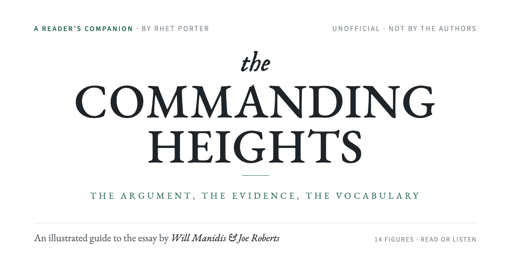

  

<i>the</i> <b>COMMANDING HEIGHTS</b> A READER’S COMPANION

  THE ESSAY BY 
  <b>Will Manidis</b> · will@willmanidis.com &nbsp;<i>&amp;</i>&nbsp; <b>Joe Roberts</b> · joe@josephjcroberts.com

  An unofficial, illustrated companion to their essay of <i>October 29, 2026.</i> 
  Prepared by <b>Rhet Porter</b>. 
  <a href="https://rhetoricalrhet.github.io/commanding-heights-guide/"><b>Open the guide</b></a> · <a href="https://commanding-heights.com/">Read the original essay ↗</a>

---

> **Not the original, and not by its authors.**
> This is an independent companion to the essay. Will Manidis and Joe Roberts did not write, review or endorse it, and it is not affiliated with them. Every summary, chart and interpretation here is my own reading. Any errors, simplifications or misrepresentations are mine, not theirs, and should not be attributed to the authors.
> — Rhet Porter

---

## What it is

*The Commanding Heights* argues that as machine intelligence becomes cheap, its lasting wealth will settle not with the labs that build models but with the few scarce, controllable positions that intelligence must pass through to reach the economy.

This companion sets that roughly 40,000-word argument out on one page, to read alongside the essay. Its design follows the original: EB Garamond, small caps, a single reading column and daggered sources.

## Contents

| | |
|---|---|
| *Prologue* | Ravi, in Bangalore, as the essay opens |
| i | The argument in brief: six propositions, and the essay as a warning |
| ii | Where the margin settles: the value chain, as this guide reads it |
| iii | The essay, part by part: all eight parts, each linked to the original |
| iv | Inventors rarely keep the fortune |
| v | The scissors: training costs up, the price of capability down |
| vi | The Line: GDP, capex, and hyperscaler cash flow |
| vii | Two sovereigns: the three tiers of intelligence and the US–China price frontier |
| viii | The Neo-Dollar: reserves since 1999, and how a payment travels |
| ix | The widening K: India's graduates, TCS, and Ravi again |
| x | Height or bottleneck? The five tests, and the Heights of past eras |
| xi | The fourth settlement of the firm |
| xii | For the allocator: bond yields since 1871, and Buffett's newspapers |
| *Closing* | Out from the garden, as the essay ends |
| *Appendix* | Glossary and open questions |

**Features:** fourteen figures redrawn from data published with the essay, with hover values, data tables and sources. A "Why the authors think so" note under each surprising claim. A link from every section to the matching passage in the original. Recorded narration with an AI voice: a Listen button and running time on each section, with the paragraph being read highlighted.

## Accuracy

- Summaries are paraphrased and checked against the essay's text. Direct quotations are short and attributed.
- Charts use the data published with the essay's own figures, or numbers it cites. The original source is named under each one. The "scissors" chart projects the essay's stated growth rates and is not observed data.
- The value-chain diagram, the positioning matrix, the "for capital" notes, the quiz examples and the open questions are this guide's synthesis and are labeled as such.
- Spotted an error or a misreading? Please open an issue with the part or note number from the original. To suggest a fix yourself, see [CONTRIBUTING.md](CONTRIBUTING.md).

## License and credit

- *The Commanding Heights* is © 2026 Will Manidis and Joe Roberts. Read it at [commanding-heights.com](https://commanding-heights.com/).
- This companion is by Rhet Porter. It is independent and not affiliated with or endorsed by the authors.
- Companion text: [CC BY 4.0](https://creativecommons.org/licenses/by/4.0/). Code: MIT (see `LICENSE`).
